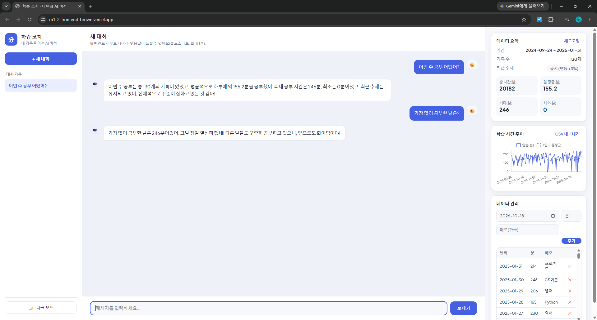
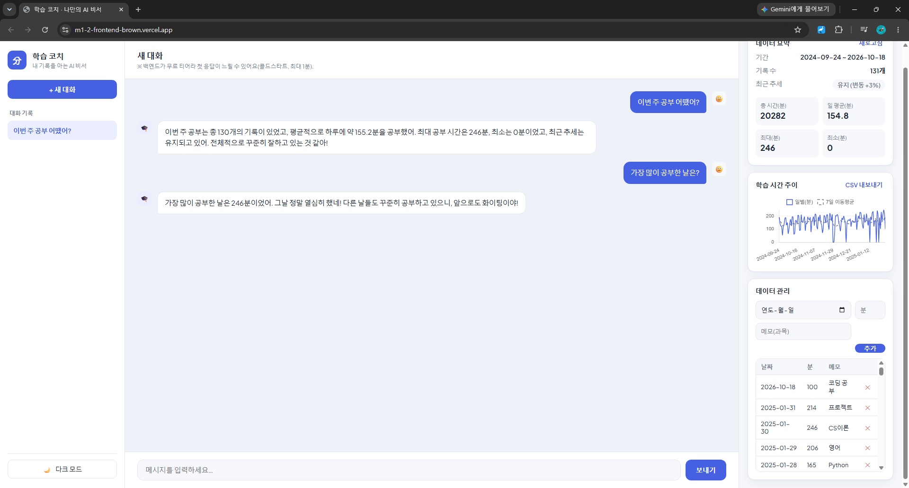
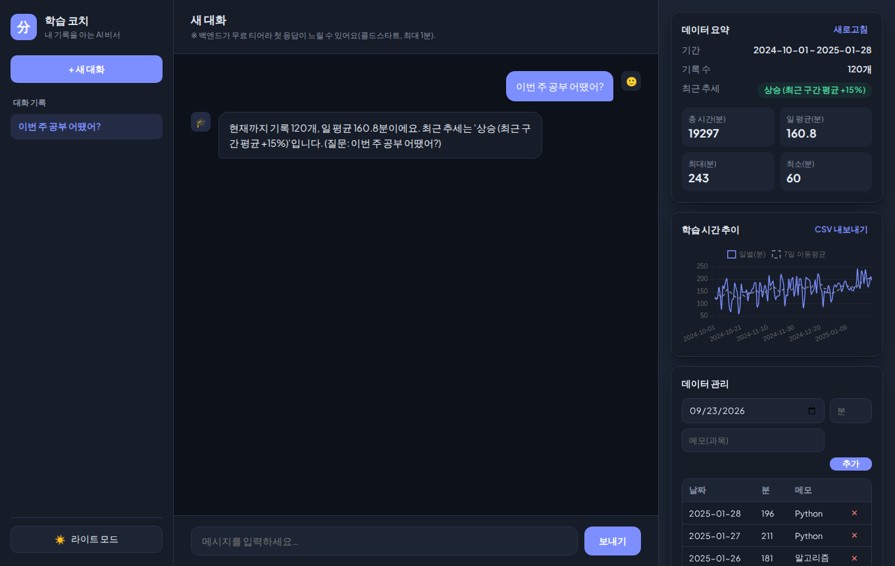

# 📚 학습 코치 — 나만의 학습 시간 AI 비서

내 학습 시간 데이터를 이해하고 맞춤형으로 답하는 AI 비서 웹 서비스입니다.
일반 챗봇은 "내가 요즘 얼마나 공부했는지"를 모르지만, 이 서비스는 내 실제 기록을
**데이터 요약 → 시스템 프롬프트 주입(컨텍스트 주입)** 방식으로 AI에게 전달해
"현재까지 기록 120개, 일 평균 160분, 최근 상승 추세"처럼 근거 있는 답을 줍니다.

## 무엇을 해결하나요?

- 흩어진 학습 기록을 한곳에 저장하고(CRUD), 기간·개수·평균·추세를 자동 요약합니다.
- 그 요약을 근거로 AI에게 "이번 주 어땠어?", "가장 많이 한 날은?" 같은 질문을 하면
  내 데이터에 기반한 맞춤형 답을 받습니다.
- 대화는 자동 저장되어 언제든 다시 불러올 수 있습니다.

## 🧱 기술 스택

| 구분 | 사용 기술 |
|------|-----------|
| 백엔드 | Python, FastAPI, Uvicorn, Pydantic |
| 데이터베이스 | Firebase Firestore |
| AI | OpenAI GPT API (`gpt-4o-mini`) |
| 프론트엔드 | HTML / CSS / JavaScript (바닐라, 프레임워크 미사용) + Chart.js(시각화 라이브러리) |
| 배포 | 백엔드 → Render / 프론트 → Vercel |

## 🌐 배포 URL

- 프론트엔드(Vercel): https://m1-2-frontend-brown.vercel.app
- 백엔드 API(Render): https://study-ai-assistant-wm3d.onrender.com
- Swagger 문서: https://study-ai-assistant-wm3d.onrender.com/docs

## 🗂 폴더 구조

```
study-ai-assistant/
├── backend/                 # FastAPI 백엔드 (→ Render 배포)
│   ├── app/
│   │   ├── config.py            # 환경변수 로드
│   │   ├── firebase.py          # Firestore 연동(지연 초기화)
│   │   ├── models/schemas.py    # Pydantic 요청/응답 검증
│   │   ├── services/            # 비즈니스 로직 (데이터/대화/AI)
│   │   └── routers/             # API 라우터 (data/conversations/chat)
│   ├── main.py                  # 앱 초기화 + CORS + 라우터 등록
│   ├── seed_data.py             # 샘플 데이터 생성/업로드
│   ├── requirements.txt
│   ├── render.yaml              # Render 배포 설정
│   └── .env.example
├── frontend/                # 바닐라 JS 프론트 (→ Vercel 배포)
│   ├── index.html
│   ├── style.css
│   ├── app.js
│   ├── config.js                # API 서버 주소 설정
│   └── vercel.json
├── data/
│   └── study_time_sample.csv    # 샘플 학습 시간 데이터(130개)
├── docs/screenshots/            # 제출 스크린샷
└── README.md
```

## 🔌 API 엔드포인트

| 메서드 | 경로 | 설명 |
|--------|------|------|
| POST | `/api/data` | 새 데이터 추가 |
| GET | `/api/data` | 데이터 목록 조회 |
| PUT | `/api/data/{id}` | 데이터 수정 |
| DELETE | `/api/data/{id}` | 데이터 삭제 |
| GET | `/api/data/summary` | 데이터 요약(프롬프트 주입용) |
| GET | `/api/data/statistics` | 확장 통계(표준편차/요일평균/시계열) — 보너스 |
| POST | `/api/conversations` | 대화 저장 |
| GET | `/api/conversations` | 대화 목록 조회(messages 미포함) |
| GET | `/api/conversations/{id}` | 특정 대화 전체 조회(불러오기) |
| DELETE | `/api/conversations/{id}` | 대화 삭제 |
| POST | `/api/chat` | AI 대화(요약 주입 + 자동 저장) |

## 💻 로컬 실행 방법

### 1) 백엔드

```bash
cd backend
python -m venv venv
source venv/bin/activate        # Windows: venv\Scripts\activate
pip install -r requirements.txt

# 환경변수 설정: .env.example 을 복사해 .env 로 만들고 값 채우기
cp .env.example .env

# 샘플 데이터를 Firestore에 넣기(선택)
python seed_data.py

# 서버 실행
uvicorn main:app --reload
# → http://127.0.0.1:8000/docs 에서 Swagger 확인
```

### 2) 프론트엔드

```bash
cd frontend
# config.js 의 API_BASE_URL 을 http://127.0.0.1:8000 로 설정(기본값)
# 정적 파일이므로 아무 로컬 서버로 열면 됩니다. 예:
python -m http.server 5500
# → http://127.0.0.1:5500
```

## 🔑 환경 변수 (최소 세트)

| 변수 | 설명 |
|------|------|
| `OPENAI_API_KEY` | OpenAI API 키 |
| `FIREBASE_SERVICE_ACCOUNT_JSON` | Firebase 서비스 계정 키 JSON(문자열). 또는 `GOOGLE_APPLICATION_CREDENTIALS`(파일 경로) |
| `ALLOWED_ORIGINS` | CORS 허용 도메인(쉼표 구분). 예: `http://localhost:5500,https://<your>.vercel.app` |
| `API_BASE_URL` | (프론트) 백엔드 API 주소. `frontend/config.js`에서 설정 |
| `OPENAI_MODEL` | (선택) 기본값 `gpt-4o-mini` |
| `OPENAI_MAX_TOKENS` | (선택) 응답 토큰 상한. 기본값 `500` (비용 방어) |

> ⚠️ **키/서비스 계정은 코드에 하드코딩하지 않습니다.** 모두 환경변수로 주입하며,
> `.env` 와 서비스 계정 키 파일은 `.gitignore` 로 커밋에서 제외됩니다.

## 🚀 배포 방법 (요약)

**백엔드 (Render)**
1. GitHub에 코드 푸시 후 Render에서 New → Web Service, 이 저장소 연결
2. Root Directory: `backend`, Build: `pip install -r requirements.txt`,
   Start: `uvicorn main:app --host 0.0.0.0 --port $PORT`
3. Environment에 위 환경변수 등록(`OPENAI_API_KEY`, `FIREBASE_SERVICE_ACCOUNT_JSON`, `ALLOWED_ORIGINS`)
4. 배포 후 `https://<service>.onrender.com/docs` 접속 확인
   - ⏳ 무료 티어는 첫 요청 시 슬립에서 깨어나며 최대 1분 지연(콜드스타트)될 수 있습니다.
     프론트 상단에 안내 문구를 표시해 사용자가 기다릴 수 있게 했습니다.

**프론트엔드 (Vercel)**
1. `frontend/config.js`의 `API_BASE_URL`을 Render 백엔드 주소로 변경
2. Vercel에서 New Project → 이 저장소 연결, Root Directory: `frontend`
3. 배포 후 발급된 프론트 도메인을 백엔드 `ALLOWED_ORIGINS`에 추가(CORS)

## 📸 제출 스크린샷

### 1. 데이터 요약이 보이는 채팅 화면 (질문 + 답변)


우측 요약 패널의 기간·개수·평균·추세가 시스템 프롬프트로 주입되어,
AI가 실제 데이터를 근거로 답합니다. 대화는 자동 저장되어 좌측 목록에 나타납니다.

### 2. 데이터 관리 화면 (CRUD)


우측 하단에서 데이터 추가(날짜/분/메모)와 삭제(✕)가 화면에서 동작합니다.
추가·삭제 시 요약과 차트가 즉시 갱신됩니다.

### 3. 대화 기록 불러오기 / 다크 모드


좌측 대화 목록에서 항목을 클릭하면 해당 대화의 전체 메시지를 다시 불러옵니다.
좌측 하단 토글로 다크 모드를 전환할 수 있습니다(보너스).

## ✨ 보너스: 인사이트·UX 고도화

- **확장 통계**: `/api/data/statistics` 에서 표준편차(꾸준함), 요일별 평균, 7일 이동평균 시계열 제공
- **시각화**: 우측 패널에 일별 학습 시간 + 7일 이동평균 라인 차트(Chart.js)
- **데이터 내보내기**: 'CSV 내보내기' 버튼으로 현재 데이터를 CSV로 다운로드
- **다크 모드**: 좌측 하단 토글, 선택은 브라우저에 저장되어 유지

## ⚠️ 비용 주의

개인 OpenAI 키 사용 시 요청마다 과금될 수 있습니다. 응답 토큰 상한(`OPENAI_MAX_TOKENS`)과
저렴한 모델(`gpt-4o-mini`)을 기본값으로 두었고, 작은 테스트 데이터로 먼저 검증하길 권장합니다.

## 📄 데이터 출처

- 본 프로젝트의 학습 시간 데이터는 데모용으로 `seed_data.py`가 생성한 합성 데이터입니다.
  (재현성을 위해 난수 시드 고정) 실제 사용 시에는 데이터 관리 화면에서 본인 기록을 입력하면 됩니다.
